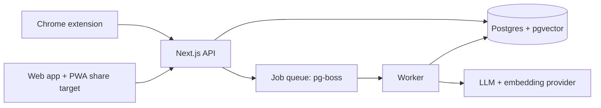

# unfold: Architecture (v2, lean)

**Date:** 20 Nov 2026 | **Status:** Re-optimised MVP blueprint

## 1. Purpose

A personal library that captures what you find interesting, remembers *why*, and lets you find it again later.

**Core promise:** Save in one action. Find it later with a vague description. See what it relates to.

**Design stance:** Search and "related" are the product. The Map is an optional view, built last and only if earned.

## 2. Principles

1. One-action capture, with an optional one-line "why".
2. Retrieval first, visualisation last.
3. Explicit save only. No history collection.
4. Original URL always one click away.
5. Compute on demand, cache what's expensive.

## 3. Scope

| Phase | Build | Exit test |
|---|---|---|
| 0. Capture | Auth, Chrome extension, PWA share target (mobile), URL dedupe, metadata, library, Postgres full-text search, "why" note | You save 20+ items in 2 weeks without friction |
| 1. Retrieval | Text extraction, AI summary + tags, embeddings, hybrid search, "related to this" list | You find a vague-memory item on 7 of 10 tries |
| 2. Threads | Nightly clustering, auto-named threads, rediscover views (old, unopened) | Threads look coherent when you inspect them |
| 3. Map (optional) | Cluster-level canvas, expand to nodes | Only if you open the Library more than the Map suggests you'd want it |

**Out of scope:** native apps, teams, social, offline archiving, history ingestion, multi-browser, notes beyond the "why".

## 4. System



- **One deployable app** (Next.js) plus **one worker** process. No separate backend service.
- **Queue lives in Postgres** (pg-boss). No Redis.
- **No object storage.** Store thumbnail/favicon URLs only.

## 5. Stack

| Layer | Choice | Note |
|---|---|---|
| Extension | Chrome MV3 + TypeScript | Capture on click/shortcut only |
| Web | Next.js + React + TypeScript + Tailwind | Installable as PWA with share target |
| DB | Postgres (Neon or Supabase) + pgvector | Single store for data, search, vectors |
| Queue | pg-boss (or Inngest) | Retries, backoff built in |
| Auth | Managed (Supabase Auth or Clerk) | Don't build this |
| AI | Thin provider interface | Swap models without code changes |
| Map (Phase 3) | Sigma.js or d3-force on canvas | React Flow only if node count stays small |

## 6. Capture pipeline

1. Save → API inserts `discovery` (status `pending`), normalises and hashes URL, returns immediately.
2. Worker, step 1 **metadata:** resolve redirects, canonical URL, title, OG tags, favicon, type.
3. Worker, step 2 **content:** extract main text (Readability), truncate, use for AI only, **do not store**.
4. Worker, step 3 **enrich:** one LLM call returns summary (≤2 sentences) + 3 to 7 tags. Embed `title + summary + tags + why-note`.
5. Status → `ready`. Each step is independently retryable; partial records stay usable.

**YouTube:** use the YouTube Data API for title, channel, description, thumbnail. Transcripts are optional enrichment, never required.

## 7. Data model

```
discovery
  id, user_id, original_url, canonical_url, url_hash (unique per user),
  title, summary, why_note, resource_type, domain, thumbnail_url, favicon_url,
  tags text[], embedding vector, search_tsv tsvector,
  status, saved_at, last_opened_at

relation            -- cached, created on demand
  user_id, a_id, b_id, score, explanation, dismissed bool

thread              -- Phase 2
  id, user_id, name, centroid vector, updated_at
thread_member
  thread_id, discovery_id, score
```

- Tags live on the discovery. Promote to a `concept` table only if you need concept-level filtering or merging.
- `dismissed` relations are never recreated.
- One discovery can sit in multiple threads.

## 8. Search and related

**Hybrid search:** combine Postgres full-text rank (title, summary, tags, why-note) with vector similarity; merge via reciprocal rank fusion. Filters: type, domain, date.

**Related:** top-k nearest neighbours by embedding (k≈5 to 8) above a similarity floor. Compute on view.

**Explanation:** a one-sentence LLM reason, generated **only when the user opens a connection**, then cached in `relation`. Phrase as inference ("Both appear to cover…"), never as fact.

## 9. Threading (Phase 2)

- **Nightly batch**, not live: cluster embeddings (HDBSCAN or agglomerative), name each cluster with one LLM call.
- Keep existing thread IDs stable by matching new clusters to old centroids.
- Items below a similarity floor stay unclustered. No thread of one.
- Split/merge logic is deferred until a real library shows it's needed.

## 10. Rediscover (Phase 2)

Simple queries before anything clever:

- Unopened for N days.
- Related to something saved this week.
- Oldest item in a thread you've recently added to.

Opt-in digest only. No push by default.

## 11. Security and privacy

- Explicit-save only; HTTPS; encryption at rest; per-user row isolation (RLS).
- Export and delete for all user data.
- Store metadata, summary, tags, embedding. No full-page copies.
- **SSRF controls for the fetcher:** http/https only; block private, loopback, link-local and cloud-metadata IPs; validate DNS result and re-validate every redirect; cap redirects, size and time.
- **Page content is untrusted input.** It goes into prompts as quoted data only. The LLM has no tools, and its output is schema-validated.
- Respect robots and don't bypass paywalls or auth.
- LLM API keys server-side only. Disclose AI processing in settings.

## 12. Cost control

- Dedupe by `url_hash` before any AI call.
- One enrichment call per discovery; truncate input.
- Relation explanations on demand and cached.
- Clustering nightly, only if new items were added.

## 13. Metrics (personal-use)

Track one primary number: **of the times you searched for something you'd saved, how often did you find it?**

Supporting: saves per week, capture success rate, time from save to searchable, share of "related" suggestions you actually open.

## 14. Risks

| Risk | Mitigation |
|---|---|
| Poor embeddings from thin metadata | Main-text extraction + why-note in the embedding |
| Wrong "related" links | Similarity floor, dismiss action, inference wording |
| Extraction failures | Partial records, retries, manual re-run |
| Map built, then unused | Gate Phase 3 on real usage |
| Unsaved mobile discoveries | PWA share target in Phase 0 |
| Existing tool already covers it | Trial Karakeep for a week before building Phase 1 |

## 15. First build

1. Extension + PWA share save a URL with an optional why-note.
2. It appears in the library instantly.
3. Worker fills metadata, summary, tags, embedding.
4. Hybrid search finds it from a vague description.
5. Detail view shows related items with on-demand explanations.

Use it daily for two weeks before starting Phase 2.
